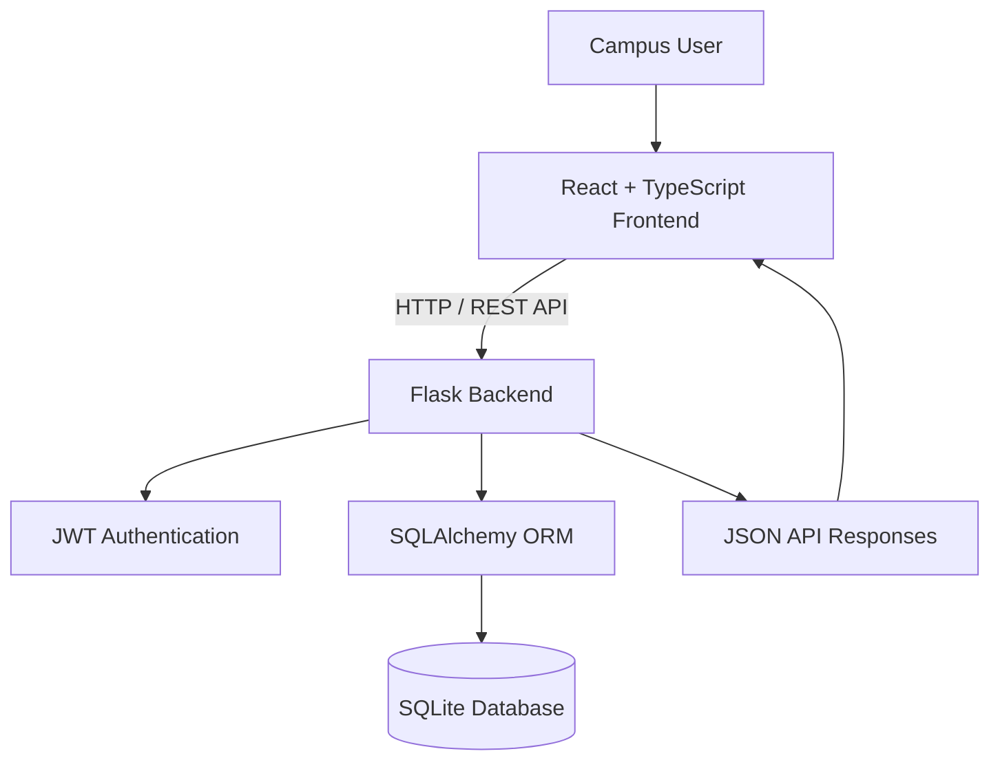

# Campus Lost & Found Portal

A full-stack web application for reporting, discovering, and managing lost and found belongings within a campus community.

The **Campus Lost & Found Portal** provides a centralized platform where students and other campus users can publish lost or found item reports, search existing listings, and track the resolution of their own reports. The project demonstrates full-stack development, REST API design, authentication, database integration, and automated backend testing.

## Overview

Finding misplaced belongings on campus often depends on informal communication, notice boards, or scattered messages. This application provides a single platform to make lost-and-found reporting more organized, searchable, and accessible.

Users can create an account, browse reports, search by item name or description, filter listings, submit new reports, and mark their own reports as resolved.

## Features

| Feature | Description |
|---|---|
| User Authentication | Register and log in using securely hashed passwords and JWT-based authentication. |
| Browse Reports | View available lost and found item reports. |
| Search and Filtering | Search reports by item name or description and filter by report type or category. |
| Report an Item | Submit a report with the item name, category, description, location, and incident date. |
| My Reports | Access reports created by the authenticated user. |
| Resolve Reports | Mark your own reports as resolved. |
| Access Control | Protect report creation and personal report management through authentication and ownership checks. |
| Persistent Storage | Store user accounts and item reports in an SQLite database. |

## Technology Stack

**Frontend**
- React
- TypeScript
- Vite
- CSS

**Backend**
- Python
- Flask
- Flask-JWT-Extended
- Flask-CORS
- SQLAlchemy

**Database and Testing**
- SQLite
- pytest

## System Architecture

The application follows a client-server architecture. The React frontend communicates with the Flask backend through REST API endpoints. The backend handles authentication, request validation, business logic, and database operations.



## Project Structure

```text
campus-lost-found/
├── backend/
│   ├── app/
│   │   ├── __init__.py
│   │   ├── database.py
│   │   └── routes.py
│   ├── tests/
│   │   ├── conftest.py
│   │   ├── test_auth.py
│   │   └── test_items.py
│   ├── requirements.txt
│   └── run.py
├── frontend/
│   ├── public/
│   └── src/
├── docs/
│   ├── diagrams/
│   │   └── diagrams.md
│   ├── project-documentation.md
│   └── test-case-report.md
├── .gitignore
└── README.md
```

## Getting Started

Follow these instructions to run the application locally.

### Prerequisites

Install the following software:

- [Python](https://www.python.org/downloads/) with `pip`
- [Node.js](https://nodejs.org/) with npm
- [Git](https://git-scm.com/downloads/) (if cloning the repository)
- A modern web browser

### 1. Clone the repository

```bash
git clone https://github.com/Joshuaparmar/campus-lost-found.git
cd campus-lost-found
```

### 2. Set up the backend

From the project root, create and activate a Python virtual environment.

**Windows PowerShell**

```powershell
cd backend
python -m venv .venv
.\.venv\Scripts\Activate.ps1
python -m pip install -r requirements.txt
```

If PowerShell prevents virtual-environment activation, consult the [Python documentation](https://docs.python.org/3/library/venv.html) for alternative activation methods.

### 3. Start the backend server

Keep the virtual environment activated and run:

```powershell
python run.py
```

The API is expected to be available at:

```text
http://127.0.0.1:5000
```

Check the health endpoint:

```text
http://127.0.0.1:5000/api/health
```

Keep this terminal open while using the application.

### 4. Set up the frontend

Open a **second terminal** and navigate to the frontend directory from the project root:

```powershell
cd frontend
npm install
npm run dev
```

Open the local URL printed by Vite, typically:

```text
http://localhost:5173
```

The frontend and backend must both be running for the complete application to work.

## API Reference

The backend exposes the following REST API endpoints.

| Method | Endpoint | Description | Authentication |
|---|---|---|---|
| `GET` | `/api/health` | Check API availability | No |
| `POST` | `/api/auth/register` | Register a new user | No |
| `POST` | `/api/auth/login` | Authenticate a user | No |
| `GET` | `/api/auth/me` | Retrieve the current user | Required |
| `GET` | `/api/items` | Browse, search, and filter reports | No |
| `POST` | `/api/items` | Create an item report | Required |
| `GET` | `/api/items/mine` | Retrieve the current user's reports | Required |
| `GET` | `/api/items/<id>` | Retrieve an individual report | No |
| `PATCH` | `/api/items/<id>/resolve` | Resolve a report owned by the current user | Required |

### Search and filtering

The item listing endpoint supports query parameters:

- `q` — search by item name or description.
- `type` — filter by report type, such as `Lost` or `Found`.
- `category` — filter by an exact category.

Example:

```text
GET /api/items?q=wallet&type=Lost
```

Protected endpoints require a valid JWT access token. Report resolution is restricted to the report creator.

## Testing

The backend uses **pytest** to test authentication, item management, search and filtering, and access control.

Run the automated test suite from the project root:

```powershell
python -m pytest .\backend\tests -v
```

### Latest recorded test results

| Metric | Result |
|---|---:|
| Tests executed | 14 |
| Passed | 14 |
| Failed | 0 |
| Warnings | 0 |
| Recorded execution time | 3.91 seconds |

The project also has seven reported browser verification checks covering browsing, authentication, report creation, personal reports, resolution, and sign-out. These results reflect the recorded verification runs and should be rechecked after significant code changes.

## Security Considerations

- **Password protection:** Passwords are stored as hashes rather than plaintext.
- **Token-based authentication:** JWT access tokens protect authenticated operations.
- **Ownership enforcement:** Users can resolve only their own reports.
- **Environment configuration:** Production deployments must use a securely generated JWT secret configured outside the source code.
- **Repository hygiene:** Virtual environments, local databases, environment files, and other generated or sensitive files should not be committed.

This project is an academic prototype. It should receive additional security review and production configuration before public deployment.

## Documentation

Detailed project documentation is available in the `docs/` directory.

- [`Project Documentation`](docs/project-documentation.md) — problem statement, objectives, requirements, architecture, and implementation details.
- [`System Diagrams`](docs/diagrams/diagrams.md) — use case, data flow, entity relationship, and system architecture diagrams.
- [`Test Case Report`](docs/test-case-report.md) — automated test results and browser verification records.

## Future Enhancements

Potential extensions include:

- Image uploads for lost and found items.
- Notifications when a potentially matching item is reported.
- Automated matching of lost and found descriptions.
- Administrative moderation and report management.
- Deployment with production-grade configuration and persistent hosting.

## Project Status

The core prototype implements user authentication, item reporting, browsing, search and filtering, personal report management, and report resolution.

The latest recorded verification includes **14 passing backend tests** and **seven browser checks reported as passing**.

---

**Developed as a Software Engineering mini-project.**

