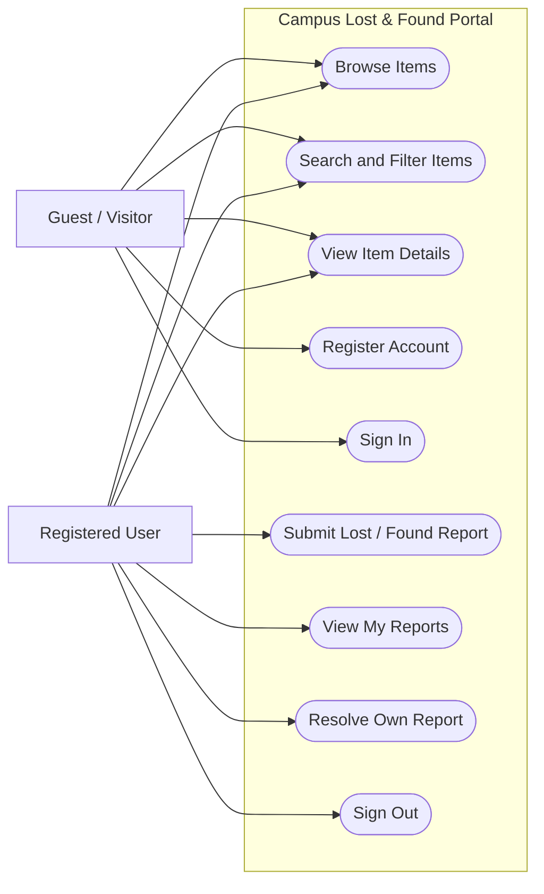
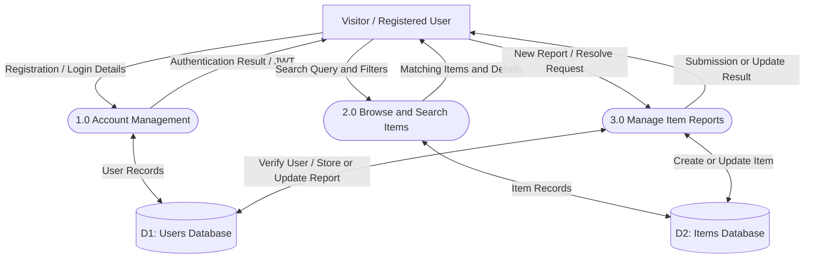
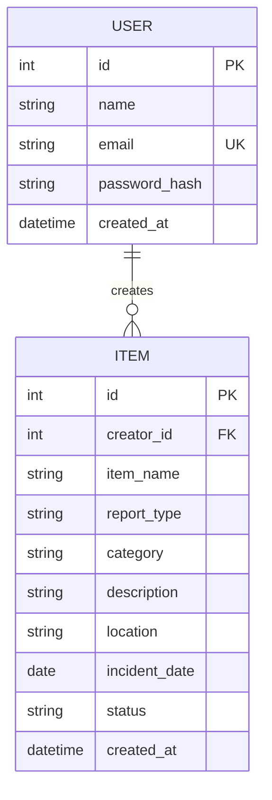
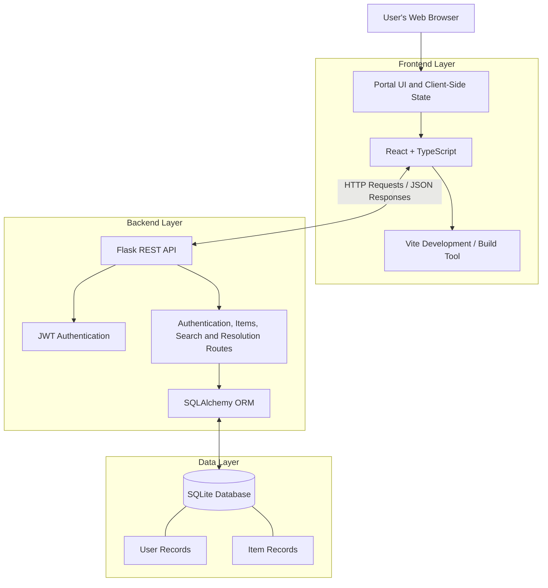

# Campus Lost & Found Portal — Software Design Diagrams

This document contains the software design diagrams for the Campus Lost & Found Portal, a web application that allows campus users to browse lost and found items, submit reports, and manage their own reports.

---

## Diagram 1 — Use Case Diagram

This diagram shows how visitors and registered users interact with the portal.

**Explanation:** Visitors can browse, search, filter, and view item details. Registered users can additionally submit reports, view their own reports, resolve their own reports, and sign out.

---

## Diagram 2 — Data Flow Diagram (DFD), Level 1

This diagram illustrates how data flows between users, application processes, and the database.

**Explanation:** Account management handles registration and login. The browsing process retrieves and filters item reports. Report management creates reports and updates their status after authentication and ownership checks.

---

## Diagram 3 — Entity Relationship (ER) Diagram

This diagram represents the database entities and their relationship.

**Explanation:**

- **USER:** Stores registered-user information. Passwords are stored as hashes, not plain text.
- **ITEM:** Stores lost and found reports, including item details, location, incident date, and status.
- **Relationship:** One user can create multiple item reports. Each item report belongs to one creator.
- **Primary and foreign keys:** `USER.id` and `ITEM.id` are primary keys; `ITEM.creator_id` references `USER.id`.

---

## Diagram 4 — System Architecture Diagram

This diagram shows the main technology layers and how they communicate.

**Explanation:** The React and TypeScript frontend communicates with the Flask REST API using HTTP requests and JSON responses. JWT authentication protects restricted operations. SQLAlchemy connects the backend to the SQLite database, which stores user accounts and item reports.

---

## Conclusion

These four diagrams document the main interactions, data flow, database relationships, and software architecture of the Campus Lost & Found Portal. They should be consistent with the implemented application and its actual database schema.
